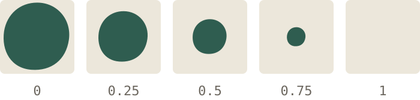

在 Unity 里写惯了 HLSL，换到网页上要面对两种着色语言：WebGL 2 用的 GLSL ES 3.0，和 WebGPU 用的 WGSL。这篇拿一个最常见的溶解效果，把三种写法放在一起对照。

> 这是一篇示例文章，用来检查排版。可以直接改写，或者删掉整个文件夹。

## 效果

采样一张噪声图，噪声值低于阈值的像素直接丢弃。阈值从 0 调到 1，物体就从完整慢慢“溶”掉。



*图 1　阈值从 0 到 1，噪声值低于阈值的像素被丢弃*

## HLSL（Unity）

```hlsl
half4 frag (v2f i) : SV_Target
{
    half n = tex2D(_NoiseTex, i.uv).r;
    clip(n - _Threshold);
    return _BaseColor;
}
```

`clip(x)` 在 `x < 0` 时丢弃像素，输出靠语义 `SV_Target` 标记。

## GLSL ES 3.0（WebGL 2）

```glsl
#version 300 es
precision highp float;

uniform sampler2D uNoiseTex;
uniform float uThreshold;
uniform vec4 uBaseColor;

in vec2 vUv;
out vec4 outColor;

void main() {
    float n = texture(uNoiseTex, vUv).r;
    if (n < uThreshold) discard;
    outColor = uBaseColor;
}
```

片元着色器里 float 没有默认精度，必须先写 `precision`；输出是一个自己声明的 `out` 变量。

## WGSL（WebGPU）

```wgsl
struct Params {
    baseColor: vec4f,
    threshold: f32,
};

@group(0) @binding(0) var<uniform> u: Params;
@group(0) @binding(1) var noiseTex: texture_2d<f32>;
@group(0) @binding(2) var noiseSampler: sampler;

@fragment
fn fs_main(@location(0) uv: vec2f) -> @location(0) vec4f {
    let n = textureSample(noiseTex, noiseSampler, uv).r;
    if (n < u.threshold) {
        discard;
    }
    return u.baseColor;
}
```

WGSL 没有精度限定符，`f32` 就是 32 位；资源要显式写 `@group` / `@binding`，纹理和采样器是分开的两个对象。

## 小结

| | HLSL | GLSL ES 3.0 | WGSL |
|---|---|---|---|
| 丢弃像素 | `clip()` | `discard` | `discard` |
| 片元输出 | `SV_Target` | `out` 变量 | `@location(0)` |
| 纹理 + 采样器 | 合在一起（`tex2D`） | 合在一起（`sampler2D`） | 分开 |
| 精度 | `half` / `float` | `precision` 声明 | `f32`（`f16` 需扩展） |
